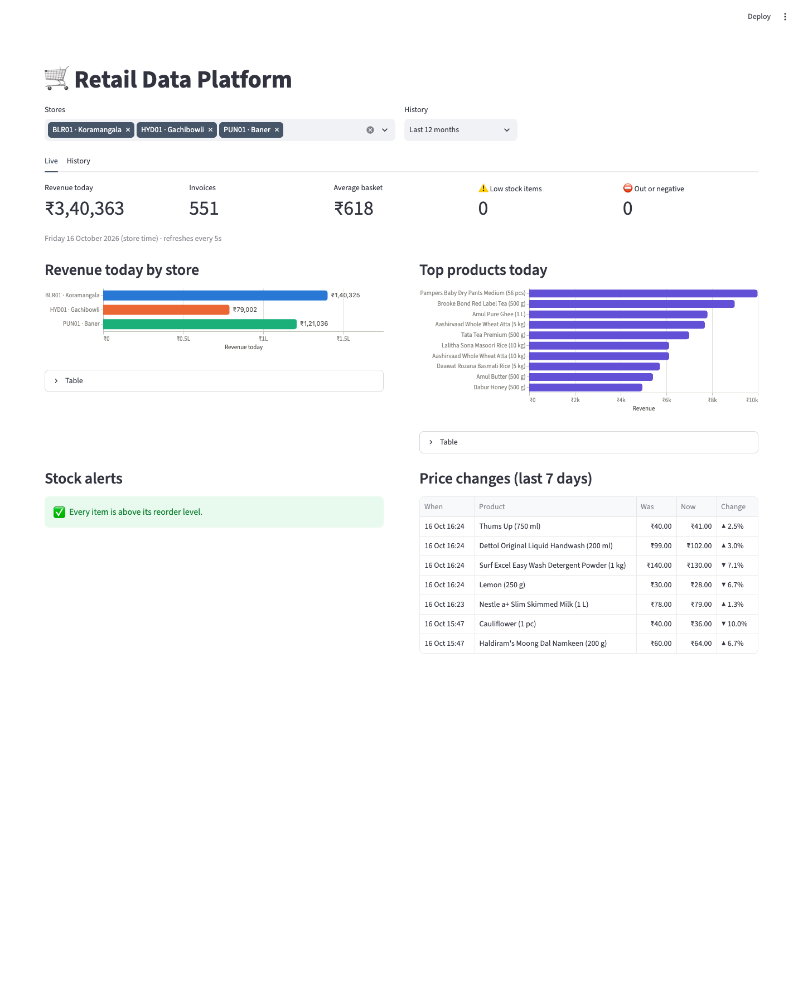
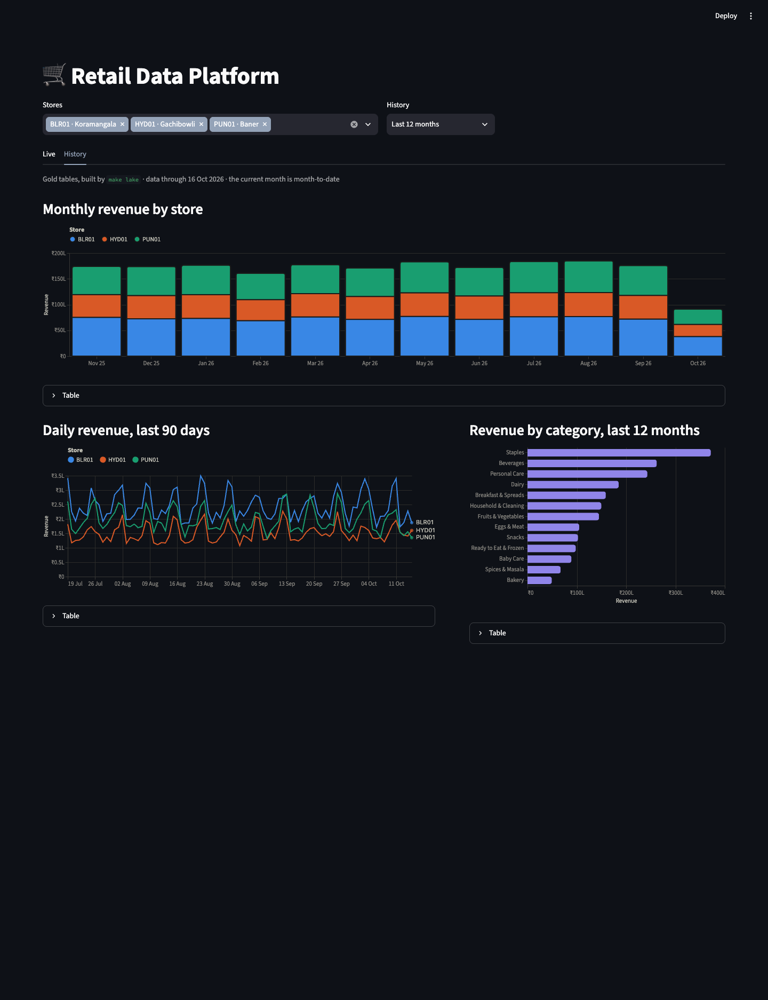
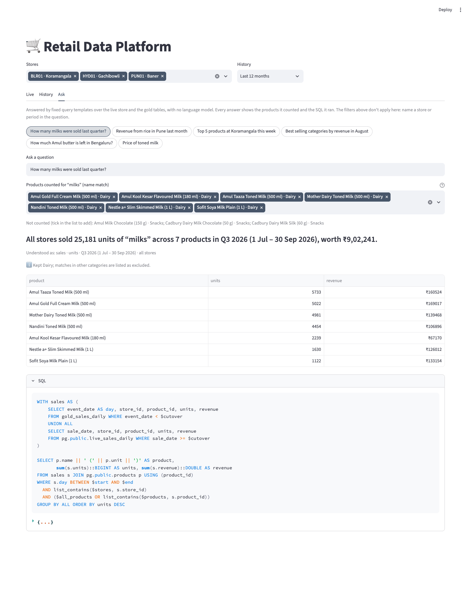

# Retail Data Platform

A supermarket data platform: invoices stream through Kafka and Spark into
live per-store stock in Postgres, while batch jobs build a Delta Lake for
history and analytics.

> Work in progress — built phase by phase. Status: **Phase 5, step 1 (search and template Q&A) complete.**

## Prerequisites (macOS, Apple Silicon)

| Tool | Version | Install |
|---|---|---|
| Docker Desktop | latest | https://www.docker.com/products/docker-desktop/ — cap memory at ~4 GB |
| Java | 17 | `brew install openjdk@17` |
| Python | 3.12 | `brew install uv` then `uv python install 3.12` |

Spark runs natively (not in Docker) to save memory.

## Quick start

```bash
make up          # Kafka (KRaft) + Postgres, waits until healthy
make db-migrate  # only for a database created before phase 5
make search-index  # embed the product catalogue into pgvector
make topics      # invoices, price-updates, stock-receipts
make install     # .venv on Python 3.12
make seed        # 3 stores, 200 products, 12 months of price history, opening stock
make history     # ~370k historical invoices -> data/raw/invoices/YYYY-MM/STORE-DATE.jsonl.gz
make lake        # Spark: dims -> bronze -> silver -> gold -> reconciliation (~35s)

# streaming: two terminals
make stream      # Spark Structured Streaming: Kafka -> Postgres + bronze
make simulate    # live invoices, price changes and restocks to Kafka (Ctrl-C to stop)
make stream-check  # every Kafka event applied exactly once? stock reconciles?
make api         # FastAPI on http://localhost:8000 (docs at /docs), used by the Ask tab
make dashboard   # Streamlit on http://localhost:8501
make peek TOPIC=invoices N=3   # newest messages on a topic
make test        # or make test-fast to skip the Spark tests
```

`make down` stops everything; `make reset` also deletes the data.

## Data

**Reference data** lives in [`seeds/`](seeds): 200 products across 12 categories
(Indian brands, INR prices, a 1–10 popularity weight) and 3 stores with a size
factor that scales their footfall.

**Events** are defined once, as Pydantic models in
[`src/retail/events.py`](src/retail/events.py), and validated on the way out:

| Topic | Key | Event | Notes |
|---|---|---|---|
| `invoices` | invoice_id | `Invoice` | Lines carry the unit price at time of sale; total must equal the lines |
| `price-updates` | product_id | `PriceUpdate` | Keyed by product so changes to one product stay in order |
| `stock-receipts` | store_id | `StockReceipt` | Supplier deliveries, triggered at the reorder level |

Money is exact `Decimal` in Python and a JSON number on the wire; timestamps are
UTC ISO-8601 with milliseconds.

**Historical files** use the exact same `Invoice` JSON as the Kafka topic, so the
bronze layer ingests the batch and streaming paths with one schema. There is one
file per store per day, like a nightly POS export. A store-day's content depends
only on `--seed`, the store and the date, and existing files are never rewritten:
re-running `make history` on a later day adds just the new days. (Bronze tracks
files by path, so a rewritten file would silently never be re-read.)

Prices are a fixed function of the month: list prices in `products.csv` apply to
October 2026 and drift ~0.5% a month either side, so the same month always gets
the same price, and the seeded `product_prices` history matches the invoices.

**Live simulator** — invoices arrive as a Poisson process (default 5/s, a
sped-up day), weighted by store size and product popularity. Every 30s one
price changes; every 10s it checks `inventory_current` for items at or below
their reorder level and schedules a delivery. It only *reads* stock: applying
sales and deliveries to Postgres is the streaming job's job (phase 3).

## Lakehouse (Delta Lake, PySpark 4.0)

Path-based Delta tables under `data/lake/`, built by
[`src/retail/lake/`](src/retail/lake) (`python -m retail.lake.run [steps]`).

| Layer | Table | Grain | How it's written |
|---|---|---|---|
| Bronze | `bronze/invoices` | one raw JSON event | Append. Files are loaded by a Structured Streaming `availableNow` query, whose checkpoint remembers which files were read |
| Silver | `silver/invoices` | invoice | Insert-only `MERGE` on `invoice_id` |
| Silver | `silver/invoice_items` | invoice line | Insert-only `MERGE` on `(invoice_id, line_no)` |
| Silver | `silver/invoice_rejects` | rejected event + reason | Idempotent append (`txnAppId` / `txnVersion`) |
| Silver | `silver/products`, `silver/stores` | dimension rows | Full reload from `seeds/` |
| Gold | `gold/sales_daily` | date × store × product | Overwrite, or `replaceWhere` from `--from-date` |
| Gold | `gold/store_daily` | date × store | Invoices, revenue, average basket |
| Gold | `gold/sales_monthly` | month × store × category | Units, revenue |

- **Incremental and re-runnable.** Bronze reads only new files and silver reads
  only new bronze rows (Delta as a streaming source). Re-running any step is safe.
- **Validation, not silent drops.** Silver rejects unparseable JSON, unknown
  `schema_version`, missing keys, non-positive qty/price, duplicate `line_no`
  and totals that don't equal their lines, recording the reason for each.
- **Store-local dates.** `event_date` is the IST calendar date, so a sale at
  00:30 IST lands on the right day even though it is 19:00 UTC the day before.
- **Reconciliation** (`make lake-check`) proves nothing was lost or double
  counted: distinct valid bronze invoices = silver invoices, line amounts sum to
  invoice totals, and every gold table sums back to silver, to the paisa.
- **Laptop tuning.** `local[4]`, 3 GB driver, 8 shuffle partitions. Tables are
  unpartitioned: ~40 MB per layer would only become many tiny files if split by day.

## Streaming (Kafka → Spark → Postgres + Delta)

[`src/retail/streaming/job.py`](src/retail/streaming/job.py) runs one Structured
Streaming query over all three topics with a 5s trigger. Each micro-batch:

1. appends invoice events to `bronze/invoices` (`source = 'kafka'`), so the batch
   pipeline picks streamed sales up with no extra code;
2. parses invoices with the **same validation code as silver**;
3. applies sales, deliveries and price changes to Postgres in **one transaction**.

Spark commits a batch's Kafka offsets only after it succeeds, so a crash means
the batch is replayed. Every write is therefore idempotent:

| Event | Postgres effect | Why a replay is harmless |
|---|---|---|
| Invoice line | `stock_qty -= qty`, `live_sales_daily += units, revenue` | Line is first claimed in `processed_lines (invoice_id, line_no)`; only lines claimed by this statement move stock (one statement, data-modifying CTEs) |
| Stock receipt | `stock_qty += qty` | `stock_receipts.receipt_id` is the ledger; only newly inserted receipts move stock |
| Price update | Close open `product_prices` row, open a new one, update `current_price` | Applied only if newer than the open row, so replays *and* out-of-order changes are skipped |
| Bronze append | Delta append | `txnAppId` + `txnVersion = batch_id`: Delta skips a batch it already committed |

Measured on a MacBook Air: ~2s from checkout to Postgres at 5 invoices/s, each
batch taking ~1.5s. Tested by `kill -9` mid-stream, selling while it was down,
and restarting: `make stream-check` confirms every Kafka invoice and receipt
was applied exactly once and that, for all 600 store-product rows,
`stock = opening − sold + received`.

The job is the only writer of `inventory_current`, so transactions can't
deadlock; with several writers you would lock rows in key order first.

## Dashboard (Streamlit)



`make dashboard` → http://localhost:8501. One filter row (stores, history
range) scopes both tabs.

- **Live** (Postgres, refreshes every 5s): revenue, invoices and average basket
  today; revenue by store; top products; stock alerts (⚠️ low, ⛔ out or
  negative); recent price changes with old → new price.
- **History** (gold Delta tables via **DuckDB**, no Spark): monthly revenue by
  store, daily revenue for 90 days, revenue by category. Ends at yesterday, since
  today is partial and lives on the Live tab.

It connects as **`retail_reader`**, a role that is read-only at the database
level (`default_transaction_read_only`, 5s `statement_timeout`), the same role
the Q&A layer will use.

Charts follow one set of rules: each store keeps one colour everywhere (a
palette checked for colour-blind separation in light and dark mode), charts not
about stores use a neutral colour no store uses, status is always icon + label,
and every chart has a table view. Dark mode uses its own colour steps rather
than an automatic inversion.

<details><summary>History tab, dark mode</summary>


</details>

## Semantic search and Q&A (no LLM yet)



Ask "How many milks were sold last quarter?" in the dashboard's **Ask** tab, or
`POST /ask` on the API. Nothing is generated by a model:

1. **Parse** ([`qa/parse.py`](src/retail/qa/parse.py)): rules pick out the intent
   (sales, top products/categories, stock, price), metric (units/revenue), stores
   and period. Dates are resolved in code ([`qa/periods.py`](src/retail/qa/periods.py)):
   "last quarter" is Q3 2026, 1 Jul – 30 Sep, and the answer says so.
2. **Resolve the subject** ([`search/resolve.py`](src/retail/search/resolve.py)) with
   hybrid retrieval, most precise signal first: category name → brand → stemmed
   full-text on product names → embedding similarity (pgvector, `bge-small-en-v1.5`
   via fastembed on CPU). When name matches span categories, only the category
   closest in meaning is kept: "milk" counts toned, full-cream and soya milk and
   lists Cadbury Dairy Milk as *excluded*. The user can untick or re-tick any product.
3. **Query** ([`qa/engine.py`](src/retail/qa/engine.py)): a fixed SQL template runs in
   DuckDB over the gold Delta tables **and** Postgres (attached read-only as
   `retail_reader`) in one statement. Days before the last gold build come from
   gold, later days from `live_sales_daily`, so nothing is double counted.
4. **Answer** with the sentence, a per-product breakdown, the matched and excluded
   products, notes (e.g. "fuzzy match, check these") and the exact SQL and parameters.

Why hybrid: on its own, the embedding model ranked butter and milk chocolate
alongside real milks for "milk", and potatoes above India Gate rice for "rice".
Literal matches are precise; embeddings only fill in when nothing matches literally.

Postgres runs a small custom image (`docker/postgres`): the same Alpine Postgres 17
with pgvector compiled in, because switching an existing data volume to the
Debian-based pgvector image would change text collation (musl vs glibc).

## Design notes

- **Stock is per store** — `inventory_current` is keyed on `(store_id, product_id)`.
- **Negative stock is allowed and flagged**, not clamped: it means sales were
  recorded faster than deliveries, which is information worth keeping.
- **Idempotency ledger** — `processed_lines (invoice_id, line_no)` will let the
  streaming job skip lines from a replayed micro-batch.
- **Invoices are keyed by invoice_id**, not store: three store keys hashed onto a
  single partition, and stock changes add up, so there's no ordering to preserve.

## Layout

```
docker-compose.yml          Kafka + Postgres
sql/init/                   Postgres schema, applied on first start
seeds/                      Product master and stores (CSV)
src/retail/
  catalog.py                Reference data + rules (reorder levels, historical prices)
  events.py                 Event contracts (Pydantic)
  seed.py                   Loads the live store
  simulator/invoices.py     Basket and invoice builder shared by both simulators
  simulator/history.py      Historical invoice files for the batch path
  simulator/live.py         Kafka producer for the streaming path
  lake/                     Spark + Delta: bronze, silver, dims, gold, checks, run
  streaming/job.py          Kafka -> Postgres + bronze (Structured Streaming)
  streaming/live_store.py   Idempotent Postgres writes for one micro-batch
  streaming/check.py        Kafka vs Postgres reconciliation
  dashboard/                Streamlit app, read-only queries (Postgres + DuckDB), charts
  search/                   Embeddings (fastembed), pgvector indexing, hybrid resolver
  qa/                       Period resolver, question parser, query templates, answers
  api/main.py               FastAPI: /search, /ask
  peek.py                   Newest messages on a topic
tests/                      Spark and Postgres tests use throwaway lakes and databases
```

## Roadmap

1. ~~Foundation~~ — infrastructure, product master, event contracts, simulators
2. ~~Batch~~ — bronze / silver / gold Delta tables with reconciliation
3. ~~Streaming~~ — Spark Structured Streaming into Postgres stock and Delta
4. ~~Dashboard~~ — Streamlit: live stock, low-stock alerts, sales, price changes
5. Semantic search and Q&A — ~~step 1: hybrid search + template Q&A~~; step 2: local LLM text-to-SQL (Ollama)
6. Hardening — data quality checks, monitoring, CI
